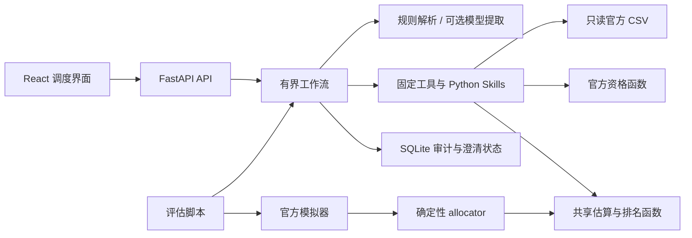

# Track 2 调度平台架构

这是本地单用户、建议型外包调度平台。官方 CSV 是业务事实来源，官方模拟器保持原样。React / TypeScript 界面通过 FastAPI 调用 Python 业务能力；SQLite 保存审计与待澄清状态。没有真实下单或发送消息的接口。

## 代码与职责

| 模块 | 职责 |
| --- | --- |
| `frontend/` | 聊天、收件箱、订单／工坊浏览、候选解释、评估、审计与设置；不计算权威交期，不持有模型密钥 |
| `backend/app/data_access.py` | CSV 类型转换、唯一键和关键数值校验、数据计数、官方文件 SHA-256 比对 |
| `backend/app/skills/` | 官方资格解释、工坊过滤、交期情景、推荐、双工坊拆单提案和过载探针 |
| `backend/app/allocator.py` | 配置化确定性排序；同一规则用于聊天与官方回放；提供 earliest_finish 简易比较策略 |
| `backend/app/tools.py` | 七个白名单工具、输入 Schema、用途及边界；规格见 `tool-spec.md` |
| `backend/app/agent/` | 双语规则解析、可选模型 Adapter、版本化 Prompt、有界流程控制 |
| `backend/app/schemas.py` | HTTP 与模型提取的 Pydantic 校验，拒绝未声明字段 |
| `backend/app/services/audit.py` | 参数化 SQLite 写入、历史查询、请求范围的澄清 Checkpoint |
| `data/`、`harness/` | 原样复制的官方 v3 数据与模拟器；不覆盖、不改计分逻辑 |
| `evals/`、`backend/tests/` | 30 条请求评估、normal／shock 多 seed 回放、业务及 API 回归测试 |

## 请求如何完成

1. 校验输入长度、会话编号和策略配置，读取同会话尚未完成的澄清状态。
2. 规则解析器提取订单、数量、日期和约束；已配置模型时，可增加经 Schema 校验的语言提取。模型不输出权威交期、费用、资格或队列。
3. 对未知订单、数据不包含的问题、多个匹配、缺失或冲突字段，返回无法回答或追问。此分支不调用推荐。
4. 确定订单后读取原始行；对 8 家工坊核对硬资格与用户约束，计算三种交期情景与成本。
5. 按目标排名，仅在期望日期按时的候选中形成建议。若指定工坊不合格，给出原因与合法替代；若无方案按时，保留空推荐，并展示最早日期与处理选项。
6. 返回结构化结果、简短中文解释、可审计来源与步骤。记录原消息、解析、约束来源、输出、耗时、数据及 Prompt 版本。

这里使用普通 Python 有界状态机，而不是 LangGraph 依赖。流程没有开放式自动工具循环；当前分支有限，普通函数更容易核验。`graph.py` 表达流程控制，但不能据文件名理解为已使用 LangGraph。

## 两种时间口径

| 场景 | 参考日与队列 | 如何解释订单 |
| --- | --- | --- |
| 聊天收件箱 | 固定 2026-04-01；`current_queue_days` 是当天早晨快照 | 面向在制订单，允许用户提供本次批量、交期与约束；本版本不对已完成订单记录生成外包建议 |
| 官方回放 | 2026-01-01 起；相同数值作为初始队列，此后由模拟器推进 | 假设 120 单均在各自 `order_date` 外包；忽略厂内完成状态、历史延期等列 |

不能用回放结果推导聊天队列，也不使用电脑当天日期覆盖业务参考日。前端中“今日”应理解为数据快照日期。

工厂入门材料描述厂内周一至周六工作；官方外包模拟器明确工坊按每周 7 天工作。本实现跟随后者。完整公式见工具规格。期望工时为 `n/c × (1+0.5p)`，随机模拟的单次实际工时则是 `n/c` 或 `1.5n/c`；它们不应混写。

官方日期按从 2026-01-01 起的绝对模拟日取 `round`。例如发送日为第 1 天、周转 2.5 天时，`round(1+2.5)=4`，不能换成 `1+round(2.5)=3`。聊天另返回按 `ceil` 计算的保守日期字段，供风险展示，不改官方评分。

## 配置化目标与权衡

硬资格和用户排除先行，所有排序都采用稳定的工坊编号作最终平局规则。

| 目标 | 确定性排序重点 | 主要权衡 |
| --- | --- | --- |
| `lateness`（主目标） | 延期概率、期望延期天数、期望周转、缺陷率、成本 | 为交期可能增加成本或缺陷暴露 |
| `quality` | 期望按时优先，然后最低缺陷率、风险、周转与成本 | 低缺陷小工坊可能积累长队列；不能把低缺陷当作快交付 |
| `fairness` | 期望按时优先，再按该次回放已分配的累计件数均衡 | 均衡件数不等于产能比例均衡，可能牺牲周转 |
| `robustness` | 延期概率、期望延期天数、返工情景周转、期望周转 | 倾向更多缓冲；只观察传入队列，不偷看停工目标或时间 |
| `hybrid` | 期望按时优先，对归一化风险、缺陷、累计负载、成本加权 | 权重代表取舍，不保证每项指标都优于单目标 |

混合默认权重：延期 0.45、质量 0.25、公平 0.15、成本 0.15。延期项为 `late_probability + expected_late_days/14`；质量除以本批合法候选最大缺陷率；公平为该工坊累计件数／累计总件数；成本除以本批合法候选最高成本。尺度有零值保护，权重须为非负有限数且总和大于零，随后归一化。

聊天每次独立估算，没有实际下单历史，因此公平策略初始累计件数全为零；不会把审计中的“建议”错误累计成“已分配”。回放使用闭包维护本次累计件数，在新回放时重置。聊天的“最快”和“按时前提下最便宜”属于明确用户偏好，分别按期望周转及合法按时候选成本排序。

## 状态、约束和安全边界

- 只有待澄清请求保留 Checkpoint，最长 24 小时。完成、拒绝或不可行回复结束本次约束范围；新明确订单不继承旧订单限制。
- 约束包含 `type`、`value`、`source`、`scope=current_request`。输入中的“Boss says”记录为提出者 Boss，不等于获得额外系统权限。
- SQLite 使用参数化查询；路径由 `AUDIT_DB_PATH` 配置。数据库、环境变量文件与运行日志不应提交版本库。
- 模型只从后端读取 `LLM_API_KEY`、`LLM_MODEL`、`LLM_BASE_URL`。无配置时使用规则模式；网络、响应或 Schema 失败时返回明确降级提示。真实外部模型效果应另行评测，不能用规则评测结果代替。
- 规则模式针对已支持的中英文格式；不支持或有冲突的数值、日期、限制应追问。它不是通用语言理解的质量保证。
- 本地模式没有多用户身份和权限隔离；部署为多人服务前需增加认证、会话所有权校验、访问限流与 TLS，不能直接把本地单用户 API 当作公网产品。

## 可选扩展与评估边界

默认关闭工序扩展，启用后使用 `orders_stages.csv` 与 `workshops_stages.csv`，并复用官方剩余工序覆盖检查。扩展模式只能与同样启用 stages 的基线比较。

双工坊拆单是明确允许后的假设提案：检查两份部分批次资格、件数与上限，以两份中较晚的日期作为整批完成日期；保留未执行标记。官方模拟器只支持一批一家，因此拆单结果不混入 120 单成绩。

normal 与 shock 使用相同 seeds 5105–5114。Shock 在模拟日 30–44（1 月 31 日至 2 月 14 日）关闭一家工坊，停工目标不传给 allocator。对三个官方基线及简易 `earliest_finish` 均报告指标；主目标之外至少报告质量与混合目标。结果需来自实际运行的评估报告，同时列出基线仍有优势的成本、缺陷或负载指标。

30 条语言请求的决策与解释应分开核查：提取正确不等于建议合法，建议合法也不允许编造说明。当前规则模式成绩与外部模型效果分开记录。原始数据完整性由 `docs/source/manifest.json` 中 SHA-256 校验，评估代码不修改官方 harness。
